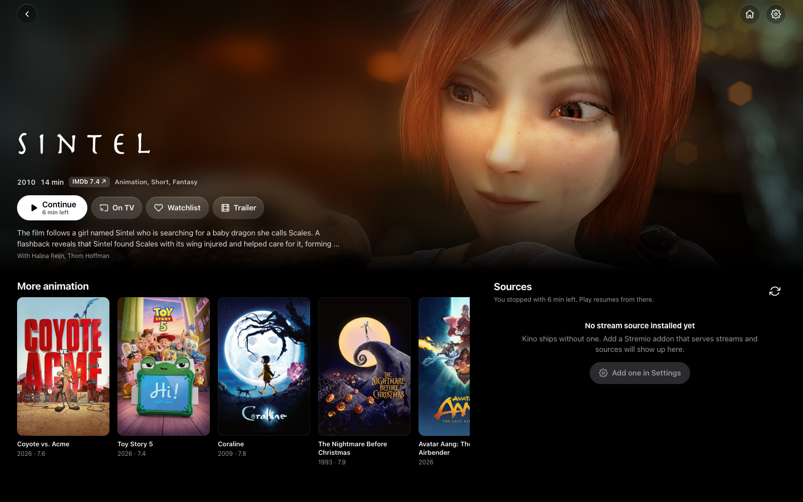
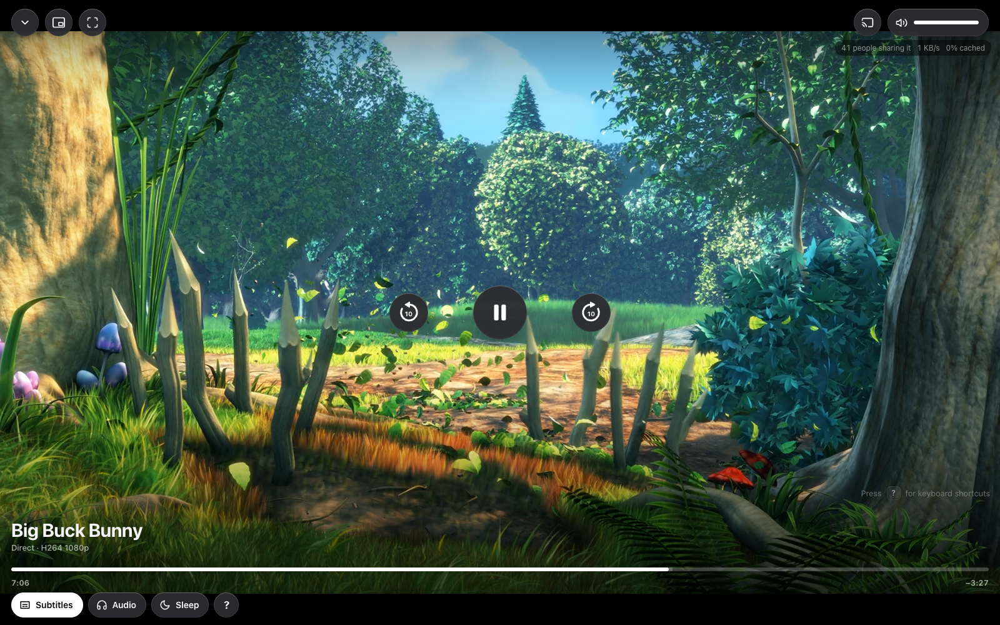
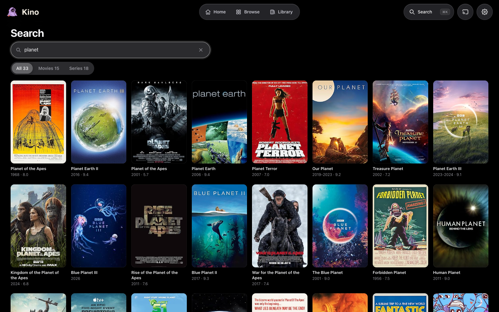
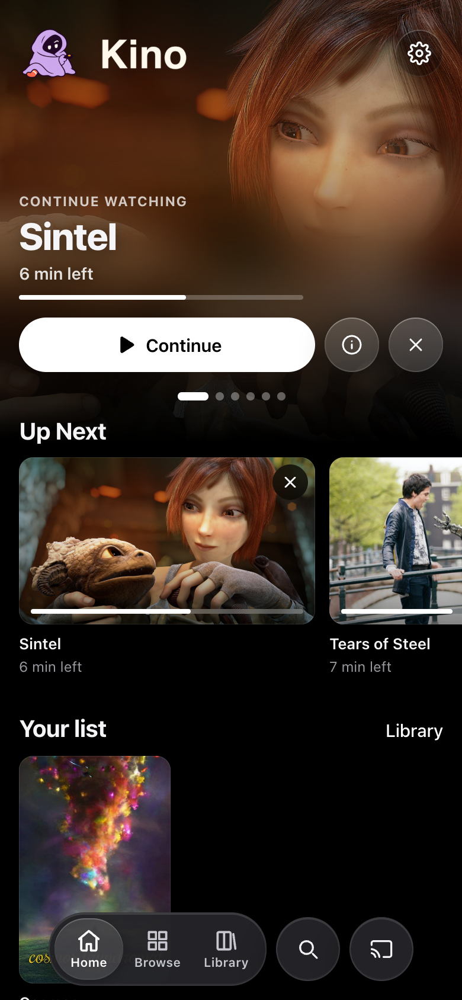
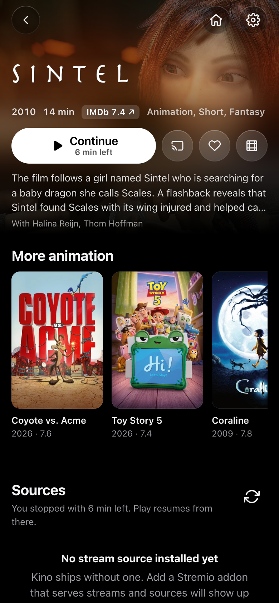

<p align="center">
  
</p>

<h1 align="center">Kino</h1>

<p align="center">
  A self-hosted media player for your home network.<br />
  Browse, pick a source, play on the device in your hand or on the TV.
</p>

<p align="center">
  <a href="#quick-start">Quick start</a> ·
  <a href="#features">Features</a> ·
  <a href="#run-it-without-the-app">Without the app</a> ·
  <a href="#away-from-home-with-tailscale">Away from home</a> ·
  <a href="#how-it-works">How it works</a> ·
  <a href="#configuration">Configuration</a> ·
  <a href="#development">Development</a> ·
  <a href="#legal">Legal</a>
</p>

<p align="center">
  
</p>

Kino is an app for your Mac (or a service on a Linux box or a NAS) that serves your whole home network. Phones, tablets and laptops use it in the browser (or as an app on the home screen), and TVs get it through Chromecast or DLNA. It speaks the [Stremio addon protocol](https://github.com/Stremio/stremio-addon-sdk/blob/master/docs/protocol.md) for catalogs, streams and subtitles, downloads only the file you are watching, and plays it as it is or converts it on the fly so it works in every browser, on an iPhone and on an old Chromecast. No accounts, no cloud, no telemetry.

> [!IMPORTANT]
> Kino ships with no content and no content sources. It is a player: what it plays is up to you and the addons you add. See [Legal](#legal).

## Quick start

Kino is a desktop app for macOS. It runs the server for the whole house and gives you a window and a menu bar icon; phones, tablets and TVs then use it over the home network.

### 1. Get the app

**Download it** (once a version is published). The [Releases page](https://github.com/vicjor/kino/releases) has a DMG for Apple Silicon Macs and an AppImage for Linux for each version. Intel Macs are not supported by the app (the server still runs there from a checkout). The app is not signed with an Apple Developer ID, so macOS refuses the first open: in **System Settings, Privacy & Security**, choose **Open Anyway** next to the message about Kino (or run `xattr -dr com.apple.quarantine /Applications/Kino.app`).

**Or build it yourself.** You need git and [mise](https://mise.jdx.dev), which installs the Node and bun versions pinned in `mise.toml`:

```sh
git clone https://github.com/vicjor/kino.git
cd kino
mise install            # Node 26 and bun
bun install             # dependencies
bun run desktop:dist    # release/Kino-<version>-arm64.dmg (on an Apple Silicon Mac)
open release
```

The first build downloads Electron and a native ffmpeg for each CPU, so it takes a few minutes. Open the DMG for your Mac and drag Kino to Applications. An app you built yourself opens without the Gatekeeper prompt.

### 2. Open it

Kino opens a window and puts an icon in the menu bar. Closing the window keeps Kino running for the rest of the house; quit from the menu bar icon. To have it running after a restart, add it under **System Settings, General, Login Items**.

The first-run walkthrough shows the address to open on phones and laptops on the same Wi-Fi (`http://kino.local` works too on most networks), sets your subtitle languages and lists the TVs it found. On an iPhone, open that address in Safari and use Share, Add to Home Screen for a full-screen app.

### 3. Add a source

Kino comes with the Cinemeta catalog (titles, posters, episodes) and OpenSubtitles (subtitles), and with no stream source. To play titles from the catalog, paste the manifest URL of a Stremio-compatible addon you use in **Settings, Sources**. Magnet links play without any addon.

The app keeps its data in `~/Library/Application Support/Kino/data`; replacing the app with a newer version keeps it. If another Kino already answers on port 1234 on this Mac, the app attaches to that one instead of starting a second server.

## Features

**Browse**
- Home with Continue Watching (position synced across every device), Your list, New Episodes for shows you follow, Coming up (the day the next episode of each show you watch airs), and discover rails that say why they are there: Because you watched, New and worth it, Hidden gems, Top rated, moods. Real co-watch recommendations with a free TMDB key, genre shelves without one. Browse by kind, genre and sort when you know what you want.
- Instant search, a command palette (`⌘K`), title pages with backdrop, plot, ratings, season picker and per-episode progress.
- Paste a magnet link and pick a file from it.
- Installable web app: add it to the iPhone home screen for full-screen playback.

**Sources**
- Streams come from Stremio addons you add yourself (paste a manifest URL in Settings). Subtitles come from OpenSubtitles out of the box.
- Each source gets clear badges: resolution, codec, HDR, audio, size, peers, release group.
- "Auto" picks for the device that will play it: first a source that can stream without stopping, then picture quality. It avoids HEVC when casting to an older Chromecast and prefers tidy 1 to 3 GB encodes.

**Play**
- Custom player: always resumes (with a Start over chip), buffered ranges, picture in picture, fullscreen, live download stats, a full keyboard map, lock-screen controls, a safety chip after an accidental rewind.
- Auto-next episode with a countdown that sticks to the same release group when it can.
- Skip intro: from a chapter, or learned the first time you skip the titles by hand.
- Direct play when the device can handle the file, on-the-fly HLS when it cannot: MKV on iOS, HEVC on Chromecast, DTS and AC3 audio, HDR tone-mapping. Hardware encoding on Apple Silicon.
- Subtitles: several per language, hash matches marked with a star, embedded tracks, files inside the torrent, audio-aligned sync. Live offset and size controls.

**Cast**
- Server-side casting to Chromecast and Google TV and to DLNA TVs (LG webOS, Samsung, Sony), so it works from iPhone Safari too. AirPlay from Safari on top.
- Cast Center: every TV and speaker on the network in one panel, live, including what other apps play. Per-device play, pause, seek, volume, stop, history with replay, "play here" hand-off, and switching to another source without losing your place.
- Subtitles on the TV, a remote on every phone, auto-next on the TV. When the credits start, every phone shows the next episode with a countdown, and the Chromecast draws it on screen.
- Every source row says what each TV on the network will do with it: plays, converts, or too heavy.
- A "Stop everything" button, also at `/api/cast/stop-all` for a Home Assistant button or an iOS Shortcut. Optional Home Assistant webhook on play, pause and stop.

**When a stream is bad**
- Switch source while watching without losing your position (`S`). Audio track menu for multi-language files (`A`).
- Stall diagnosis: after a few rebuffers Kino says why (no peers, download slower than the video, converter behind) and offers the next best source, or a download for later.
- Download for later: keep a slow source until it is complete, then watch it without stutter.

**Ratings and tidiness**
- IMDb rating on every title and episode, from IMDb's public dataset files. Rotten Tomatoes and Metacritic with an optional free OMDb key.
- Only the file being watched is downloaded. 10 GB cache (least recently used goes first), refuses to start below 3 GB free.
- One JSON file for state, plain log files, restarts itself under launchd or systemd.

<table>
  <tr>
    <td></td>
    <td></td>
  </tr>
  <tr>
    <td></td>
  </tr>
</table>

<p align="center">
  
  &nbsp;&nbsp;
  
</p>

<sub>Screenshots show films released under open licences (Blender Foundation) or in the public domain. Posters and metadata come from public catalogs.</sub>

## Run it without the app

For an always-on home server (a Mac mini in a cupboard, a Linux box, a NAS), run Kino as a background service with no window and open it in the browser. It is the same Kino.

### macOS: a service that starts at login

Requirements: [mise](https://mise.jdx.dev) (or Node 26 and [bun](https://bun.sh) installed yourself; versions are pinned in `mise.toml`).

```sh
git clone https://github.com/vicjor/kino.git
cd kino
mise install            # Node 26 and bun
./scripts/install.sh    # dependencies, build, a launchd agent with your paths, opens Kino in the browser
```

ffmpeg and ffprobe come in as npm packages at install time. At boot Kino checks that each one actually runs and otherwise uses Homebrew's (`/opt/homebrew/bin`, `/usr/local/bin`), MacPorts' (`/opt/local/bin`) or the one on `PATH`. The ffprobe package's Apple Silicon binary is an Intel build, so a Mac without Rosetta needs `brew install ffmpeg`.

To update: `git pull && make deploy-safe`. It waits until nobody has been watching for five minutes, builds the committed code and restarts. `make deploy-local` restarts now but refuses while someone is watching (`FORCE=1` overrides). Both keep the previous build: `make rollback-local` puts it back.

### Linux, or anything with Node 26

```sh
git clone https://github.com/vicjor/kino.git
cd kino
mise install                       # Node 26 and bun
bun install --frozen-lockfile && bun run build
bun start                          # http://localhost:1234
```

To keep it running, `ops/kino.service` is a systemd user unit (instructions inside). Casting needs the machine on the same network as the TVs: mDNS for Google Cast, SSDP for DLNA. Docker on macOS cannot do either, so run Kino natively there.

Then open it from a phone or laptop as in [Quick start](#2-open-it), and add a source the same way.

## Away from home with Tailscale

Kino has no accounts and trusts its network, so never expose it to the internet. To use it from outside the house, put it on your own [Tailscale](https://tailscale.com) network (free for personal use):

1. Install Tailscale on the machine that runs Kino and on your phones and laptops, signed in to the same account.
2. On the Kino machine, run `tailscale serve --bg 1234`. Kino is now at `https://<machine>.<tailnet>.ts.net`, for your devices only; the first time, Tailscale asks you to turn on HTTPS for your tailnet. `tailscale serve status` shows the address, `tailscale serve reset` turns it off. Do not use `tailscale funnel`: that puts it on the public internet.
3. Set a PIN, so a shared or lost device does not open your library. This takes the service install (the app has no PIN setting yet):
   ```sh
   plutil -replace EnvironmentVariables.KINO_PIN -string 'your-pin' ~/Library/LaunchAgents/com.kino.plist
   sh scripts/restart.sh http://localhost:1234 reload
   ```
   Running `scripts/install.sh` or `make install-local` again writes a fresh plist, so add it again after those. On Linux, add `KINO_PIN=your-pin` to `Environment=` in the systemd unit.

Tips:
- Add the `ts.net` address to your phone's home screen as well: it is HTTPS, so the installable app works there too.
- From away you can still start and control casts to the TVs at home. The TV fetches the video from Kino over the home network, not through your phone.
- Watching away from home streams over your home upload. If a file stutters, pick a smaller source (Auto already prefers lean ones).
- Kino answers to `.ts.net` names out of the box. Any other name in front of it (your own domain, a router DNS name) goes in `KINO_HOSTS`.

## How it works

```
phone / laptop browser ──HTTP + SSE──▶ kino (Node 26, Express 5, :1234)
                                         ├─ webtorrent        one file at a time  → ~/kino-data/cache/<infoHash>/
                                         ├─ ffprobe + ffmpeg  direct | remux | transcode → HLS in ~/kino-data/hls/
                                         ├─ Stremio addons    catalogs (Cinemeta), streams, subtitles
                                         ├─ castv2 / UPnP     Chromecasts and DLNA TVs pull media from kino over the LAN
                                         └─ state.json        progress, watchlist, following, settings, cache index
```

1. **Metadata** comes from Cinemeta (the public Stremio catalog): search, popular titles, episode lists. TMDB and IMDb's dataset files add recommendations and ratings.
2. **Sources** come from every configured addon that serves `stream`. Kino asks them all, parses the release names into structured fields, counts peers on the trackers and ranks the results for the device that will play: first whether the swarm can deliver the file well within its running time (so it never stops to buffer), then picture quality.
3. **Playback** starts a webtorrent session that selects only the chosen file. ffprobe reads the first bytes over a range request, and a small decision matrix picks *direct* (serve the file with HTTP 206), *remux* (ffmpeg `-c:v copy` into HLS) or *transcode* (H.264, hardware on Apple Silicon, libx264 otherwise). Browsers and iOS get fMP4 HLS, older Chromecasts get MPEG-TS.
4. **Casting** is done by the server: `castv2-client` for Chromecasts, UPnP AVTransport for DLNA TVs. The TV fetches the file or the HLS playlist straight from Kino, with subtitles alongside. Any phone on the LAN can control it through `/api/cast/*` and gets live status over SSE.
5. **Subtitles** come from subtitle addons (matched by file hash when possible), tracks embedded in the file (extracted with ffmpeg) and subtitle files inside the torrent. Everything is normalised to WebVTT.

[docs/specs](docs/specs) holds design notes with the reasoning behind parts of it.

### Repo layout

The module map. Pure logic has unit tests in `test/`.

```
server/            Express API and everything behind it (TypeScript, ESM)
  index.ts         boot: middleware in order, /health, store, torrent client, cast and DLNA discovery, reapers, port 80 redirect
  host.ts          Host check: 421 for any name but IPs, localhost, .local, .ts.net, this Mac and KINO_HOSTS
  csrf.ts          refuses a write that a page on another site sent (403)
  pin.ts           KINO_PIN: cookie token, wrong-PIN pauses, the media URLs TVs fetch without the cookie
  health.ts        busy: what a restart would interrupt
  lifecycle.ts     orphaned transcoders at boot, 503 while stopping, the shutdown sequence
  net-guard.ts     outbound fetches from addon-supplied URLs: refuses private and loopback targets, walks redirects by hand
  errors.ts        httpError, safe state keys, the JSON error handler
  routes/          the HTTP API: one router per part (browse, library, play, subs, cast, settings), mounted in
                   order by routes/index.ts, shared checks in util.ts
  home.ts          everything /api/home returns, in one response
  settings.ts      one check for settings writes and restored backups
  config.ts        every environment variable, paths, default addons, LAN IP pick
  store.ts         state.json, one file, atomic writes, schema migrations
  addons.ts        Stremio addon fan-out, manifest checks, addon catalog
  meta.ts          Cinemeta catalogs, search, meta, next episode, running time
  episode-name.ts  "Show S2 E3 Title", the one name an episode is saved and cast under (the client imports it too)
  parse.ts         release names into structured sources
  score.ts         rank sources per target device: streams without stopping first, then quality
  rank.ts          the one ranking path (source list and TV auto-next): live seeders, running time, score.ts
  picks.ts         local log of sources played from a list and what became of them (picks.jsonl), to tune score.ts on
  scrape.ts        seeders counted on the trackers
  torrent.ts       one webtorrent client, one selected file at a time, LRU cache
  downloads.ts     download for later
  discover.ts      Home rails and Browse pages (docs/specs/2026-09-17-discover-design.md)
  years.ts         Browse's release-year window: read from the query, matched against a title's year, as TMDB dates
  taste.ts         what you watch, as numbers: seeds, genres, language
  tmdb.ts          trending, co-watch recommendations, discover (optional key)
  upcoming.ts      Coming up: when the next episode airs
  ratings.ts       IMDb dataset dumps, OMDb
  events.ts        SSE to every client
  mdns-name.ts     kino.local via dns-sd (macOS)
  ha.ts disk.ts http.ts log.ts   webhook, disk guard, fetch + TTL cache, JSON logs
  types.ts         DTOs shared with the client; types/ holds .d.ts for untyped deps
  media/           bins (the ffmpeg and ffprobe that run), probe, decide, range, hls, credits, intro
  media/credits-lookup.ts  where one file's credits and opening titles sit, from what you skipped before, chapters, subtitles
  cast/            discovery (bonjour + dns-sd), session, manager, monitor (live device state), timeout (bounds every
                   Chromecast request), dlna, upnext, keepawake (a paused Chromecast stays on)
  cast/lg.ts       an LG TV's own remote protocol (webOS SSAP over a websocket), to turn it off; the pairing key in lg-keys.json
  cast/dnssd.ts    Chromecasts through the system dns-sd, for a Mac where Home Assistant holds udp/5353
  subs/            OpenSubtitles hash, srt/vtt, audio-aligned sync, embedded and in-torrent tracks, signed ids (ids.ts,
                   secret.key), disk cache
  subs/oshash.ts   the OpenSubtitles hash of a file in a torrent (size plus first and last 64 KiB)
  subs/srt2vtt.ts  subtitle text from bytes (UTF-8, UTF-16, Windows-1252), SRT to WebVTT and back, shifted by an offset
client/            Vite + React 19, hand-written CSS, PWA (no UI library)
  App.tsx main.tsx hash-routed shell, lazy-loaded screens
  screens/         Home, Search, Browse, Library, Title, Player, Settings, Magnet, Onboarding;
                   Player has two halves: playing here, or TvRemote (tv=true in the link: the TV's remote, same look)
  components/      Dock, Card, Row, SourceList, CastCenter, CastPicker, Controls, Scrubber, PlayOn (where it plays),
                   EpisodesShelf, Shortcuts, CommandPalette, ...
                   plus pure helpers with tests: home-data, moods, source-tags
  lib/             api, store, sse, router, player-caps, hls-attach, vtt, intro, progress, format, plus urls (route
                   builders, no DOM), episodes, tvs, keys (g chords), cast-actions (send to TV, play here), cast-volume,
                   spring (damping and response springs, momentum projection), paging, zoom (poster to title), tilt, years,
                   scrub (iOS scrubbing speeds), devices ("This iPhone")
  styles/          one CSS file per screen or component
  public/          web manifest, service worker, icons
desktop/           Electron wrapper: window, tray, embedded server (main.cjs)
launchd/           com.kino.plist.template, rendered with real paths by scripts/plist.sh (install.sh, make install-local)
ops/               systemd user unit for Linux
scripts/           install.sh, plist.sh, deploy-safe.sh and the pieces make shares with it (deploy-lock, restart, swap-dist, health-state), desktop.sh, ffmpeg-dmg.sh
test/              node:test unit tests
docs/              specs/ (design and the why), security-advisories.md, screenshots/
```

## Configuration

Everything user-facing lives in **Settings** inside the app: addons (paste a manifest URL, or pick a subtitle addon from the list), subtitle languages and size, automatic subtitles, auto-next and its countdown, cache size and the free-space floor, a TMDB key (trending, recommendations, hidden gems), an OMDb key (Rotten Tomatoes, Metacritic), the Home Assistant webhook, backup and restore, diagnostics, and the first-run walkthrough. The rest is environment variables, set in the launchd plist or the systemd unit. These are all the server reads (`server/config.ts` reads each one, and a test keeps this table in step with it):

| Variable | Default | What |
|---|---|---|
| `PORT` | `1234` | HTTP port |
| `KINO_DATA` | `~/kino-data` | cache, HLS segments, subtitles, `state.json` |
| `KINO_LAN_IP` | auto (en0, en1, eth0 first, VPN tunnels last) | the address TVs and Chromecasts use to fetch media, if auto-detection picks the wrong interface |
| `KINO_HOSTNAME` | `kino` | macOS only: registers `<name>.local` on the LAN (dns-sd) so phones can open `http://kino.local`. `off` disables |
| `KINO_PLAIN_PORT` | `80` | extra listener that redirects to the real port, so the URL needs no `:1234`. `0` disables |
| `KINO_CLIENT_DIR` | `dist/client` | built client to serve |
| `FFMPEG_BIN`, `FFPROBE_BIN` | first that runs: ffmpeg-static / ffprobe-static, Homebrew, `/usr/local/bin`, MacPorts, `PATH` | override the binary. Used as given; the log warns if it does not run |
| `KINO_NO_HW` | unset | set to disable VideoToolbox hardware encoding |
| `KINO_PIN` | unset | ask for this PIN before showing the library. Media URLs stay open to GET and HEAD for TVs. Every 5 wrong PINs from one visitor, or 30 from everyone, pause logins for a minute, then twice as long each time, up to an hour |
| `KINO_HOSTS` | unset | more host names Kino answers to, comma-separated (`kino.home.arpa`, or `.example.org` for every name under it). IP addresses, `localhost`, `.local` and `.ts.net` names and this Mac's own name always work; any other name gets 421, which stops DNS rebinding |
| `LOG_LEVEL` | `info` | `debug`, `info`, `warn`, `error` |
| `KINO_LOG_FILE` | unset (desktop app: `kino.log` next to its data folder) | also append every log line to this file, rotated at 10 MB with 3 files kept (the file plus `.1` and `.2`). stdout and stderr stay as they are |

### Endpoints worth knowing

- `GET /health` json: version, uptime, `busy` (someone is watching: a cast, a transcode or a stream; the deploy scripts read it), free disk, active torrents, cast state, and whether ffmpeg and ffprobe run (`ffmpeg`, `ffprobe`, with `ffmpegPath`, `ffprobePath`). The boot log says which binary was picked and why others were skipped. With `KINO_PIN` set, a browser without the PIN cookie gets only `ok`, `version`, `uptime` and `busy`.
- `GET /api/events` SSE: `cast.status`, `cast.receivers`, `downloads`, `torrent.stats`, `hls.state`, and `server.restart` right before a restart so clients reconnect calmly.
- `GET /api/cast/receivers` every TV and speaker with what it is playing; `POST /api/cast/receivers/:id/{play,pause,stop,seek,volume}`.
- `GET /api/ratings/:type/:id` IMDb (per episode for series), Rotten Tomatoes, Metacritic.
- `GET /api/file/:infoHash/:idx` range-capable raw file (used by browsers, Chromecast and ffmpeg alike). Only for a torrent Kino already has (loaded, cached or a download): any other hash is a 404, so this open URL cannot start a new torrent.
- `POST /api/cast/stop-all` stops every app on every cast device on the LAN. Handy from a Home Assistant button or an iOS Shortcut.
- Request bodies are JSON and need `Content-Type: application/json` (in a Home Assistant `rest_command`, set `content_type`). A write that a browser sends from a page on another site gets a 403; curl, Home Assistant and Shortcuts send no `Origin` and pass.

### Keyboard shortcuts

`⌘K` opens the command palette anywhere, `/` opens search. In the player: `Space` play or pause, `J` `L` (or the arrows) seek 10 s, `F` fullscreen, `C` subtitles, `S` switch source. The Cast Center controller takes the same keys for the TV. Press `?` in the player or the Cast Center for the full list; source: `client/components/Shortcuts.tsx`.

## Troubleshooting

- **Every title says "no sources"**: no stream addon is installed. Kino ships with none: in Settings, Sources, paste the manifest URL of an addon you use.
- **The TV is not in the list**: Chromecasts and DLNA TVs only answer while they are on; the list refreshes by itself once they wake up. Google Cast needs mDNS, DLNA needs SSDP, both need the phone, the TV and this machine on the same Wi-Fi (guest networks usually block it). If the TV shows up but playback fails, set `KINO_LAN_IP` to the address the TV can reach.
- **A TV without a Chromecast (LG, Samsung, Sony)**: those appear as DLNA renderers. On iPhone and Mac, AirPlay from the player's AirPlay button also works.
- **Stutters on the TV, fine on the laptop**: an older Chromecast cannot decode HEVC, so Kino transcodes; pick an H.264 release (the scorer already prefers them for the TV) or use the DLNA path where the TV decodes itself.
- **Subtitles run early or late**: nudge them from the subtitle menu (`[` `]` on a keyboard). If they are minutes off, the file is a different cut than the subtitle; pick another subtitle or one marked with a star (hash match).
- **"Port in use"**: another Kino is running (a launchd install next to `bun start`, or the desktop app). Stop one, or run the second on another `PORT`.
- **Diagnostics**: Settings, About shows the version, transcoder, IMDb data age, devices found and the data folder. `/health` returns the same as JSON; logs are in `~/Library/Logs/kino/`.
- **Log files**: under launchd, `~/Library/Logs/kino/kino.log` and `kino.error.log` are launchd's stdout and stderr and never rotate. launchd opens them for appending, so emptying one in place is safe while Kino runs (`: > ~/Library/Logs/kino/kino.log`). For a rotated log instead, add `KINO_LOG_FILE` to the plist's `EnvironmentVariables` (a full path such as `/Users/you/Library/Logs/kino/kino-rotated.log`: launchd does not expand `~`) and, if you like, point `StandardOutPath` at `/dev/null`; keep `StandardErrorPath` so a crash before the logger starts still leaves a trace. The desktop app writes `~/Library/Application Support/Kino/kino.log`.

## Development

```sh
bun install
bun run dev        # server on :1234 (tsx watch) + vite on :5173 with /api proxied, also on http://kino.local:5173 for phones
bun run dev:iso    # the same on :1299 + :5174 with its own data in ~/kino-dev, next to a running Kino
bun run dev:desktop # dev:iso plus the Electron window on :5174 (API :1299, ~/kino-dev; hot reload, devtools open)
bun run test       # node:test
bun run typecheck  # server, client, tests and vite.config.ts
bun run build:check # server + client build into temp dirs (dist/ untouched), prints the entry chunk size, fails if sw.js pre-caches a file the build lacks
bun run build      # dist/server + dist/client
```

`bun run build` writes the `dist/` a running install serves from disk: on the Mac that runs Kino, building in that checkout ships to production. `bun run build:check` is the routine check that it builds. Its checks on the built client live in `scripts/verify-build.ts`, which `make deploy-safe` and `make deploy-local` also run before a build replaces `dist/`.

If Kino already runs on :1234 (launchd, the desktop app), `bun run dev` refuses to start (`scripts/dev-guard.ts`): its API could not bind the port and the vite client would proxy to that install and its data. Use `bun run dev:iso` (or `dev:desktop`) there, or `KINO_DEV_ATTACH=1 bun run dev` to use the running one on purpose. `KINO_API_PORT` picks the API port vite proxies to (default 1234), `KINO_DEV_DATA` the data folder of `dev:iso` and `dev:desktop`. Each checkout keeps its own vite cache (`node_modules/.vite-<folder>-<hash>`), so worktrees that share one `node_modules` do not overwrite each other's.

### Building the desktop app

`bun run desktop` runs the Electron app, `bun run desktop:dist` builds the DMGs into `release/`. Both rebuild `dist/`; in the checkout your launchd Kino serves (the service install above), that is the `dist/` it serves, so there they refuse unless `DEPLOY=1` is set. Anywhere else, a fresh clone or a `git worktree`, they just run. The Linux AppImage: `bun run build && bunx electron-builder --linux --publish never`. Run from a worktree, `bun run desktop` puts its server on :1299 with a throwaway data folder (`PORT` and `KINO_DATA` override), and dev and worktree windows get their own Electron app folder, so they run next to an installed Kino.app.

The DMG is Apple Silicon only and ships a native ffmpeg and ffprobe: `scripts/ffmpeg-dmg.sh` fetches jellyfin-ffmpeg's portable GPL build, pinned by version and checksum, and puts its licence and source link next to the binaries. `desktop:dist` packs `node_modules` as it is (every native module is Node-API), so run `bun install` in that checkout first, not a `node_modules` symlinked from another, and on an Apple Silicon Mac: it refuses on Intel, whose `node-datachannel` binary would not load in the app.

Releases: push a tag (`git tag v0.1.0 && git push origin v0.1.0`) and `.github/workflows/release.yml` builds the macOS DMG and the Linux AppImage and attaches them to a GitHub release. The installed app checks that release and offers to update itself.

See [CONTRIBUTING.md](CONTRIBUTING.md) for conventions.

## Legal

Kino is a media player and a BitTorrent client, in the same way as any general-purpose torrent client or media center. It hosts no media, indexes nothing, and links to no content. It ships with no torrent sources, no catalog of torrents and no list of stream addons, and it does not recommend any. Out of the box it plays magnet links and files you point it at, and looks up subtitles.

Any addon is a third-party service you choose to add, and what it returns is that service's responsibility. You decide what Kino plays, downloads and shares (BitTorrent uploads while it downloads). Make sure you have the right to do so under the laws where you live, including copyright law.

Issues and pull requests that name, link to or ask for help with sources of infringing content will be closed.

Titles, posters and descriptions come from public catalogs: Cinemeta, IMDb's [non-commercial datasets](https://developer.imdb.com/non-commercial-datasets/) (downloaded by your install, never bundled), and with your own key TMDB and OMDb. This product uses the TMDB API but is not endorsed or certified by TMDB.

## License

[MIT](LICENSE). Copyright 2026 Victor Jørgensen.

The macOS desktop builds include ffmpeg and ffprobe from [jellyfin-ffmpeg](https://github.com/jellyfin/jellyfin-ffmpeg), unchanged, under the GPL v3; their licence text and source link are in `Kino.app/Contents/Resources/ffmpeg/`. The Linux AppImage includes the binaries of the `ffmpeg-static` and `ffprobe-static` npm packages, under their own licences. Kino runs them as separate programs.
